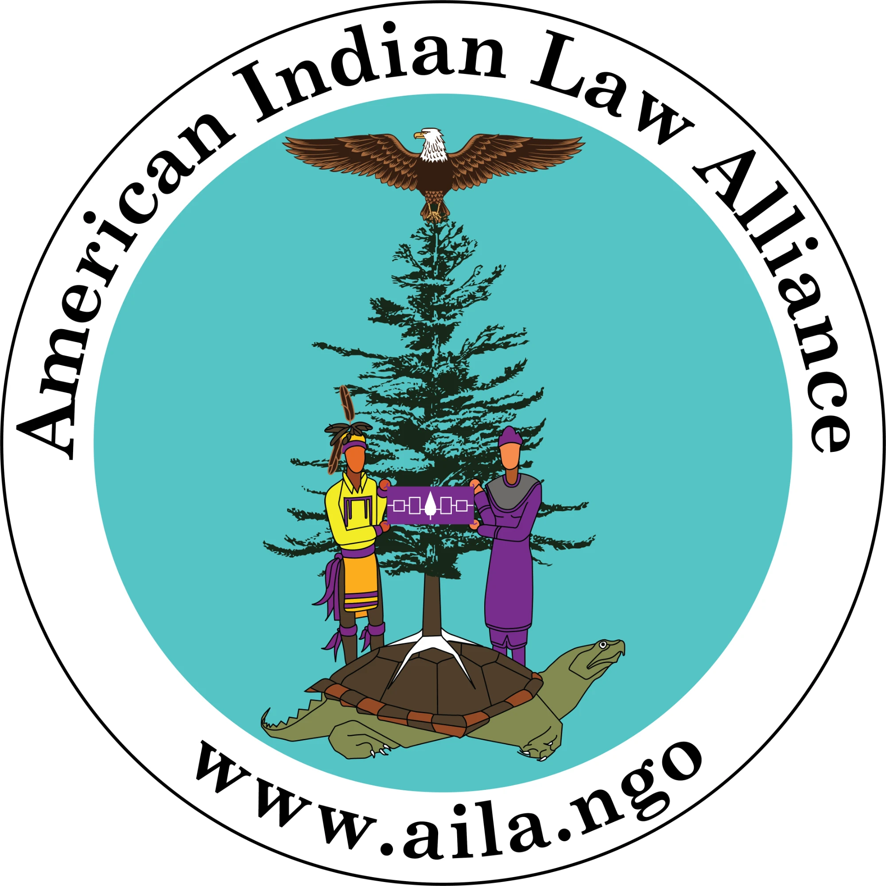
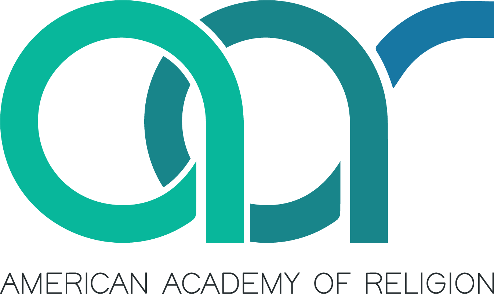

# Healing the Sacred

## Restoring Onondaga Lake through Story, Ceremony, and Public Scholarship

A podcast from the American Indian Law Alliance about Onondaga Lake: the sacred site where the Great Law of Peace was established, the damage industry did to it, and the work of returning it to the Onondaga Nation. Onondaga Nation citizens, Haudenosaunee leaders and teachers, and their neighbors tell the story in their own words.

### Curriculum Guide

Adam DJ Brett and Betty Hill (Lyons)

 

*Healing the Sacred* is produced by Betty Hill (Lyons) (Onondaga Nation, Snipe Clan) and Adam DJ Brett, in collaboration with the [American Indian Law Alliance](https://aila.ngo/). It is funded by the American Indian Law Alliance and, in part, by the inaugural Public Scholarship Grant of the [American Academy of Religion](https://aarweb.org/).

---

## Table of Contents

- [Series Details](#series-details)
  - Description, Episodes and Transcripts, Themes, Before You Teach, Hosts, Guests, Key Questions, Key Resources
- [Episode 1: The Eagles Return to Onondaga Lake, Part 1](#episode-1-the-eagles-return-to-onondaga-lake-part-1)
- [Episode 2: The Eagles Return to Onondaga Lake, Part 2](#episode-2-the-eagles-return-to-onondaga-lake-part-2)
- [Episode 3: Jake Edwards on Onondaga Lake and the Ganohé:nio](#episode-3-jake-edwards-on-onondaga-lake-and-the-ganohénio)
- [Episode 4: Rex Lyons on Lacrosse and the Haudenosaunee Nationals, Part 1](#episode-4-rex-lyons-on-lacrosse-and-the-haudenosaunee-nationals-part-1)
- [Episode 5: Rex Lyons on Lacrosse and the Haudenosaunee Nationals, Part 2](#episode-5-rex-lyons-on-lacrosse-and-the-haudenosaunee-nationals-part-2)
- [Episode 6: Tadodaho Sidney Hill on the Peacemaker and Onondaga Lake](#episode-6-tadodaho-sidney-hill-on-the-peacemaker-and-onondaga-lake)
- [Episode 7: Joseph J. Heath on Onondaga Land Rights and the Lake, Part 1](#episode-7-joseph-j-heath-on-onondaga-land-rights-and-the-lake-part-1)
- [Episode 8: Joseph J. Heath on Onondaga Land Rights and the Lake, Part 2](#episode-8-joseph-j-heath-on-onondaga-land-rights-and-the-lake-part-2)
- [Episode 9: Richard Hill on the Great Law, Wampum, and the Two Row](#episode-9-richard-hill-on-the-great-law-wampum-and-the-two-row)
- [Episode 10: Matilda Joslyn Gage and the Haudenosaunee, Part 1](#episode-10-matilda-joslyn-gage-and-the-haudenosaunee-part-1)
- [Episode 11: Matilda Joslyn Gage and the Haudenosaunee, Part 2](#episode-11-matilda-joslyn-gage-and-the-haudenosaunee-part-2)
- [About This Curriculum Guide](#about-this-curriculum-guide)

---

## Series Details

### Description

Onondaga Lake lies in Central New York State. For the Haudenosaunee Confederacy it is the sacred site where Gayanashagowa, the Great Law of Peace, was established. Many of its neighbors grew up knowing it for something else. Tina Thomas, a guest in the first episode, was raised on the west side of Syracuse. What she knew about the lake as a child was that it was toxic and that you stayed out of the water.

*Healing the Sacred* is a podcast about that lake and the people responsible for it. Across eleven episodes, hosts Betty Hill (Lyons), Patricia Nolan Vogt, and Adam DJ Brett talk with Onondaga Nation citizens, the Tadodaho of the Haudenosaunee Confederacy, the Nation's General Counsel, a Tuscarora historian, and the director of the Matilda Joslyn Gage Foundation. The guests describe how bald eagles came back to nest on the shore and why lacrosse is a medicine game. They tell what the Peacemaker taught at the lake. They explain how United States courts dismissed the Onondaga Nation's land rights action and why the Nation took its case to the Inter-American Commission on Human Rights. They say what the Two Row Wampum asks of treaty partners and what Matilda Joslyn Gage learned from Haudenosaunee women.

The series takes its name from an article by Adam DJ Brett and Betty Hill (Lyons), "Healing the Sacred: The Fight to Restore Onondaga Lake and Honor Indigenous Land," in the *International Journal on Responsibility*. Like the article, the podcast holds that returning Onondaga Lake to the Onondaga Nation is a vital step toward restoring this sacred place and toward healing for its people, the surrounding communities, and the natural world.

This curriculum guide is for instructors in religious studies, Indigenous studies, environmental studies, law, history, and gender studies. Each episode can be assigned on its own. The four two-part conversations are best assigned together.

### Episodes and Transcripts

11 episodes. Run times: TBD.
Total series run time: TBD.

The series has not been released yet. When it is, episodes and transcripts will be at [podcast.lakeback.org/episodes](https://podcast.lakeback.org/episodes/). Each episode page will link a transcript (PDF) and give a citation for the episode in Chicago, RIS, CSL JSON, and BibTeX formats.

### Themes

- Onondaga Lake as a sacred site
- The Great Law of Peace and the Peacemaker
- Industrial pollution and the Superfund cleanup
- Haudenosaunee sovereignty and the Onondaga Nation's land rights action
- The Doctrine of Christian Discovery in United States law
- Treaties, wampum, and the Two Row
- The Thanksgiving Address (Ganohé:nio) and responsibility to the natural world
- Lacrosse as a medicine game and as an expression of sovereignty
- Haudenosaunee women and the women's rights movement
- Land return and #LakeBack

### Before You Teach

Whose land do you teach on? The speakers in this series are sharing what they have chosen to share in public, and several of them are speaking about teachings that are sacred to them. Ask students to listen first for what the speakers say those teachings require of people. Questions about whether a teaching is "true" can wait until students can say what the teaching is. When students want to know more about the Great Law, wampum, or ceremony, send them to the Onondaga Nation's own website before any outside account.

### Hosts

**Gaeñ hia uh, Betty Hill (Lyons)** (Onondaga Nation, Snipe Clan) is President and Executive Director of the American Indian Law Alliance (AILA) and an Indigenous and environmental activist. She has worked for the Onondaga Nation for over 20 years, serves on the Haudenosaunee External Relations Committee, and has taken part in the United Nations Permanent Forum on Indigenous Issues since its first session in 2001 as a delegate of the Onondaga Nation. She hosts episodes 3 through 8.

**Patricia Nolan Vogt** (Onondaga descent) is Program Coordinator and Caseworker for the Executive Director of the American Indian Law Alliance. She has worked for the Onondaga Nation for over 20 years and serves as co-treasurer of the Onondaga Nation Ladies Fire Department Auxiliary. She hosts episodes 1, 2, 10, and 11.

**Adam DJ Brett** (Irish-American Ancestry) is International Research Associate at the American Indian Law Alliance and has been involved with AILA since 2016. He earned his Ph.D. in religion at Syracuse University. His work concerns the Doctrine of Christian Discovery, religious freedom, and how religion is understood through law. He hosts episode 9.

### Guests

- **Tina Thomas** (Onondaga Nation, Eel Clan), cultural educator and former Education Associate at the Skä•noñh Great Law of Peace Center. Episodes 1 and 2.
- **Sarah Shute**, environmental scientist and former staff member at the Skä•noñh Great Law of Peace Center. Episodes 1 and 2.
- **Jake Edwards** (Onondaga Nation, Eel Clan), Haudenosaunee diplomatic appointee. Episode 3.
- **De Ho Wih Da Dis, Rex Lyons** (Onondaga Nation, Eel Clan), lacrosse player, coach and administrator, and musician. Episodes 4 and 5.
- **Tadodaho Sidney Hill**, Tadodaho of the Haudenosaunee Confederacy and a citizen of the Onondaga Nation. Episode 6.
- **Joseph J. Heath**, full-time General Counsel for the Onondaga Nation since 1983. Episodes 7 and 8.
- **Richard W. Hill Sr.** (Tuscarora Nation, Beaver Clan), artist, historian, and educator. Episode 9.
- **Ciarrai Eaton**, Executive Director of the Matilda Joslyn Gage Foundation. Episodes 10 and 11.

### Key Questions

1. What makes a place sacred, and what does it mean to say that a sacred place has been desecrated? How do the speakers in this series answer?
2. How has the Doctrine of Christian Discovery shaped what United States courts will and will not do about Haudenosaunee land?
3. What is the difference between cleaning up a lake and healing it? Who decides when the work is finished?
4. The Haudenosaunee speakers describe law, treaties, and land as relationships that carry responsibilities. How does that differ from treating them as documents and property, and what follows from the difference?
5. What do the neighbors of an Indigenous nation owe that nation? What would returning land at Onondaga Lake change for the Nation, for the surrounding communities, and for the lake?

### Key Resources

Each episode's own list puts sources from the Onondaga Nation and from Haudenosaunee authors first. This series-wide list is alphabetical.

1. Arnold, Philip P., and Sandra L. Bigtree. "The Haudenosaunee (Iroquois) Great Binding Peace." *The New Ecozoic Reader*, no. 9 (September 2025): 126–29.
2. Bergeron, Emily. "From Sovereignty to Superfund: The Onondaga Nation's Legal Battle for Land Rights, Environmental Justice, and the Remediation of Onondaga Lake." PhD diss., Cornell University, 2017.
3. Brett, Adam DJ, and Betty Lyons Hill. "Healing the Sacred: The Fight to Restore Onondaga Lake and Honor Indigenous Land." *International Journal on Responsibility* 9, no. 1 (2026): article 2. https://doi.org/10.62365/2576-0955.1133. The authors are two of this podcast's hosts, and the series takes its name from the article.
4. *City of Sherrill v. Oneida Indian Nation of New York*, 544 U.S. 197 (2005). https://tile.loc.gov/storage-services/service/ll/usrep/usrep544/usrep544197/usrep544197.pdf.
5. Effler, S. W., and R. D. Hennigan. "Onondaga Lake, New York: Legacy of Pollution." *Lake and Reservoir Management* 12, no. 1 (1996): 1–12. https://doi.org/10.1080/07438149609353992.
6. Frichner, Tonya Gonnella. *Preliminary Study of the Impact on Indigenous Peoples of the International Legal Construct Known as the Doctrine of Discovery*. E/C.19/2010/13. United Nations Economic and Social Council, Permanent Forum on Indigenous Issues, 2010. https://aila.ngo/assets/documents/DOD5.pdf.
7. Gage, Matilda Joslyn. *Woman, Church & State*. 1893. Project Gutenberg, May 4, 2014. https://www.gutenberg.org/ebooks/45580.
8. Heath, Joseph J. "The Doctrine of Christian Discovery and Domination: How It Has Been Used by United States Courts to Deny Treaty Rights & Dismiss the Haudenosaunee Land Rights Cases." *Journal for Cultural and Religious Theory* 25, no. 1 (Spring 2026): 51–60. https://jcrt.org/archives/25.1/heath/.
9. Heath, Joseph J. "The Doctrine of Christian Discovery: Its Fundamental Importance in United States Indian Law and the Need for Its Repudiation and Removal." *Albany Government Law Review* 10, no. 1 (2017): 112–56. https://www.albanygovernmentlawreview.org/article/23984.
10. Hill, Richard W., Sr., and Daniel Coleman. "The Two Row Wampum-Covenant Chain Tradition as a Guide for Indigenous-University Research Partnerships." *Cultural Studies ↔ Critical Methodologies* 19, no. 5 (2019): 339–59. https://doi.org/10.1177/1532708618809138.
11. Hill, Sidney (Tadodaho). "Declaration of Tadodaho Sidney Hill, Onondaga Nation." *Onondaga Nation v. State of New York*, Civil Action No. 05-CV-314 (N.D.N.Y. Nov. 15, 2006). https://www.onondaganation.org/mediafiles/pdfs/lgl_alrtssiddecl.pdf.
12. *Johnson v. M'Intosh*, 21 U.S. (8 Wheat.) 543 (1823). Excerpts and commentary at https://doctrineofdiscovery.org/johnson-v-mcintosh/.
13. Kimmerer, Robin Wall. *Braiding Sweetgrass: Indigenous Wisdom, Scientific Knowledge and the Teachings of Plants*. Milkweed Editions, 2013. See the chapter "The Sacred and the Superfund."
14. Lyons, Oren, and John Mohawk, eds. *Exiled in the Land of the Free: Democracy, Indian Nations, and the U.S. Constitution*. Clear Light Publishers, 1992.
15. Miller, Robert J. "The Doctrine of Discovery: The International Law of Colonialism." *Indigenous Peoples' Journal of Law, Culture, & Resistance* 5 (2019): 35–42. https://www.jstor.org/stable/48671863.
16. Neighbors of the Onondaga Nation. *Neighbor to Neighbor, Nation to Nation: Readings About the Relationship of the Onondaga Nation with Central New York USA*. Rev. and expanded ed. Neighbors of the Onondaga Nation, 2014. https://peacecouncil.net/sites/default/files/NOON-booklet-web.pdf.
17. Newcomb, Steven T. *Pagans in the Promised Land: Decoding the Doctrine of Christian Discovery*. Fulcrum Publishing, 2008.
18. Onondaga Nation. "Declaration." Accessed November 14, 2026. https://www.onondaganation.org/land-rights/declaration/.
19. Onondaga Nation. "Land Rights." Accessed November 14, 2026. https://www.onondaganation.org/land-rights/.
20. Onondaga Nation and the Haudenosaunee. *Petition to the Inter-American Commission on Human Rights Against the United States*. April 14, 2014. https://www.onondaganation.org/mediafiles/pdfs/un/Onondaga%20OAS%20Petition%204-14-14.pdf.
21. *Onondaga Nation v. New York*, 500 F. App'x 87 (2d Cir. 2012) (summary order). https://doctrineofdiscovery.org/assets/pdfs/onondaga_nation_v._state_of_ny.pdf.
22. Parmenter, Jon. "The Meaning of *Kaswentha* and the Two Row Wampum Belt in Haudenosaunee (Iroquois) History: Can Indigenous Oral Tradition Be Reconciled with the Documentary Record?" *Journal of Early American History* 3, no. 1 (2013): 82–109. https://doi.org/10.1163/18770703-00301005.
23. Powless, Brad. "Birth of a Nation: Five Warring People Join to Become the Haudenosaunee." Onondaga Nation. Accessed November 14, 2026. https://www.onondaganation.org/history/.
24. Powless, Bradley. "Two Row Wampum – Gaswéñdah." Onondaga Nation. Accessed November 14, 2026. https://www.onondaganation.org/culture/wampum/two-row-wampum-belt-guswenta/.
25. Rine, Holly Anne. "Onondaga Lake as Sacred Space and Contested Space." *Review of International American Studies* 16, no. 1 (2023): 187–221. https://doi.org/10.31261/rias.13185.
26. Rine, Holly A. "Onondaga Lake in New York State: Seventeenth Century Origins of a Superfund Site." *Environment and History* 31, no. 3 (2025): 300–304. https://doi.org/10.3828/whpeh.63861480327362.
27. Wagner, Sally Roesch. *Sisters in Spirit: Haudenosaunee (Iroquois) Influence on Early American Feminists*. Native Voices, 2001.

---

## Episode 1: The Eagles Return to Onondaga Lake, Part 1

Run time: TBD

Host: Patricia Nolan Vogt

Guests: Tina Thomas (Onondaga Nation, Eel Clan) and Sarah Shute

Key Topics: Onondaga Lake, Skä•noñh Great Law of Peace Center, the eel as a sign of the lake's health, bald eagles, contamination and bioaccumulation, Great Law of Peace, Thanksgiving Address (Ganohé:nio), teaching the history of a place, resilience

### Description

Patricia Nolan Vogt talks with Tina Thomas and Sarah Shute, former educators at the Skä•noñh Great Law of Peace Center, a Haudenosaunee cultural center on the shore of Onondaga Lake near Syracuse (Skä•noñh is an Onondaga greeting meaning "Peace and Wellness"). Thomas, raised on Syracuse's west side, was told to stay out of the water. She reads the lake's health through the eel: as a member of the Eel Clan she knows the eel is "the first animal to leave" poisoned water, and none has yet been seen there. Shute learned of the lake's mercury contamination as an environmental consultant, clipping snapping-turtle toenails for lab analysis.

Then the eagles. During the 2020 COVID closure the two listened each morning to the Thanksgiving Address (Ganohé:nio) and watched bald eagles take over an old red-tailed hawk nest. In 2022, as Shute recalls it, a pair nested at the Center, which she calls the first bald eagle nest "in recorded history on the shores of Onondaga Lake." Thomas describes guarding it from people who tried to climb the tree. Shute describes photographers who first crowded the nest and then helped protect it. She worries about toxins in the fish the eagles eat, yet calls their persistence resilience. Can a returning species signal healing while the lake bed is still contaminated?

### Discussion Questions

1. How did Tina Thomas's and Sarah Shute's understanding of Onondaga Lake change as they learned more about its cultural and environmental significance?
2. What does the return of bald eagles to Onondaga Lake mean to Thomas and Shute, and what concerns remain about the lake's environmental health?
3. Thomas and Shute began each tour by having visitors look at the lake and ended it at the exhibit on the Great Law of Peace coming together on its shores. What were they trying to teach with that order, and how much of that lesson, in your view, concerns care for the lake as well as peace among people?
4. Thomas reads the lake's health through the eel, whose absence tells her the water is "still not clean," while Shute read it through lab tests on snapping-turtle toenails. Compare these two ways of knowing whether a lake is healthy: what can each notice that the other might miss?
5. Shute says the people who crowded the eagles' tree for photographs were "mostly well-meaning," yet "when you're well-meaning, you can still cause harm," and she adds that many photographers later helped protect the nest. Using this case, explain how public attention can both harm and help a recovering place.

### Additional Resources

- [Onondaga Lake](https://www.onondaganation.org/land-rights/onondaga-lake/): The Onondaga Nation's own overview of the lake, which places the Peacemaker's gathering on its shore and sets out its main pollution problems, including mercury.
- [Honeywell ceases dredging of pollutants in sacred Lake](https://www.onondaganation.org/news/2015/honeywell-ceases-dredging-of-pollutants-in-sacred-lake/): The Nation's statement of January 14, 2015, which joins the Peacemaker, the Tree of Peace and the eagle to its objections to the end of dredging.
- [Declaration](https://www.onondaganation.org/land-rights/declaration/): The Nation's vision for a clean Onondaga Lake, set out in the order of the Thanksgiving Address and naming the eagle among the beings a restored lake would hold.
- [Thanksgiving Address: Greetings to the Natural World](https://americanindian.si.edu/environment/pdf/01_02_Thanksgiving_Address.pdf): PDF from the Smithsonian's National Museum of the American Indian with the words of the Thanksgiving Address in English, for reading alongside the episode.
- [Skä•noñh Great Law of Peace Center Opens Across from Onondaga Lake](https://lakeback.org/timeline/2015-skanonh/): LakeBack timeline entry on the 2015 opening of the Haudenosaunee cultural center where the guests worked, on the site of the former Sainte Marie among the Iroquois mission.
- Rine, Holly A. "Onondaga Lake in New York State: Seventeenth Century Origins of a Superfund Site." *Environment and History* 31, no. 3 (2025): 300–304. https://doi.org/10.3828/whpeh.63861480327362. Five-page article that runs from the Great Law of Peace and colonization through industrial mercury discharge to the 2022 eagle nest.
- Effler, S. W., and R. D. Hennigan. "Onondaga Lake, New York: Legacy of Pollution." *Lake and Reservoir Management* 12, no. 1 (1996): 1–12. https://doi.org/10.1080/07438149609353992. Peer-reviewed scientific overview of the lake's industrial and municipal pollution.
- [Saving a Sacred Lake: A Century of Pollution Haunts the Haudenosaunee](https://aila.ngo/saving-a-sacred-lake-a-century-of-pollution-haunts-the-haudenosaunee/): AILA excerpt of an *American Indian* magazine profile, with a link to the full article on the pollution history the guests describe.
- [Sean Kirst: At a sacred place, 'mindblowing' tale of the nesting eagles of Onondaga Lake](https://centralcurrent.org/sean-kirst-at-a-sacred-place-mindblowing-tale-of-the-nesting-eagles-of-onondaga-lake/): Central Current column on the eagles nesting at the Skä•noñh Center and the people who watch over them.

---

## Episode 2: The Eagles Return to Onondaga Lake, Part 2

Run time: TBD

Host: Patricia Nolan Vogt

Guests: Tina Thomas (Onondaga Nation, Eel Clan) and Sarah Shute

Key Topics: the eagle in the Great Law of Peace, protecting the nest without argument, Maple Bay and land return, relationship versus stewardship, Thanksgiving Address (Ganohé:nio), seven generations, Onondaga language learning, slowing down and noticing

### Description

Continuing with Patricia Nolan Vogt, Tina Thomas and Sarah Shute turn from the nest to what the eagle means. Thomas explains that in the Great Law of Peace "the eagle sat at the top of the tree," first to see danger coming, and that eagle feathers on the men's headpieces mark them as people who watch and protect. She and Shute protected the nest with reports, phone calls and emails rather than argument, because the Great Law is about "talking and working these things out."

Vogt then asks what could grow at Maple Bay, a stretch of shore on the northwest side of Onondaga Lake that the LakeBack campaign asks Onondaga County to return to the Onondaga Nation. One answer sees a precedent "across Turtle Island" (North America). Thomas questions the premise: "we actually never said we owned anything. It was a shared place." She dislikes the word "steward." In closing, Shute describes the Thanksgiving Address (Ganohé:nio), "the words that come before all else," as daily gratitude that looks ahead seven generations. Thomas teaches it in a weekly class, with phone apps in the Onondaga language. If the Onondaga never claimed to own the lake, what would returning Maple Bay change?

### Discussion Questions

1. What does the eagle represent in the Great Law of Peace, and how does its role as a guardian connect to Thomas and Shute's efforts to protect the eagles at the Skä•noñh Center?
2. How do Thomas and Shute describe the Thanksgiving Address as a way of building relationships with the natural world? In what ways might people bring these teachings into daily life?
3. Why do Thomas and Shute stress learning the Indigenous history of the places where we live? How might a relationship with the land change the way people treat it?
4. Asked what could grow at Maple Bay if it were returned, one guest calls the return an example of "ancestral lands" being "rightfully returned," while Thomas says the Onondaga "never said we owned anything" and calls the lake "a shared place." Explain how these two answers differ in what they assume about land.
5. Thomas says she and Shute protected the nest "without having to argue with anybody," because "the whole idea of the Great Law of Peace is talking and working these things out." What are the strengths and limits of that approach for protecting a place that many people share?

### Additional Resources

- [Declaration](https://www.onondaganation.org/land-rights/declaration/): The Onondaga Nation's vision for a clean Onondaga Lake, set out in the order of the Thanksgiving Address. It is the Nation's own statement of what a restored shore would hold, including the eagle and the maple.
- [Symbolism of 2 Governments](https://www.onondaganation.org/government/symbolism/): The Nation's account of what the Peacemaker's symbols mean, including the eagle on top of the Tree of Peace that Thomas describes.
- [Honeywell ceases dredging of pollutants in sacred Lake](https://www.onondaganation.org/news/2015/honeywell-ceases-dredging-of-pollutants-in-sacred-lake/): The Nation's statement of January 14, 2015, which reads the eagle as a warning about the state of the lake and its cleanup.
- [Thanksgiving Address: Greetings to the Natural World](https://americanindian.si.edu/environment/pdf/01_02_Thanksgiving_Address.pdf): PDF from the Smithsonian's National Museum of the American Indian with the words of the Thanksgiving Address in English, for reading alongside the episode.
- [Forming an Advisory Committee to Study and Plan for the Eventual Transfer of County-Owned Property Abutting Onondaga Lake to the Onondaga Nation](https://lakeback.org/pdfs/Onondaga-land-transfer-committee-resolution-5-3-16.pdf): One-page Onondaga County Legislature resolution of May 3, 2016, the county's own text on transferring a parcel of lakeshore parkland to the Nation.
- [Where Is Maple Bay?](https://lakeback.org/blog/2024-02-19-where-is-maple-bay/): LakeBack post with a map from Neighbors of the Onondaga Nation that places Maple Bay on the northwest side of Onondaga Lake.
- [FAQ](https://lakeback.org/faq/): The LakeBack campaign's answers on why it seeks Maple Bay and how the land would be used. Its legal claims are the campaign's position.
- Williams, Kayanesenh Paul. *Kayanerenkó:wa: The Great Law of Peace*. University of Manitoba Press, 2018. Full account of the Great Law, including the Tree of Peace.
- ['The blood in our veins': Onondagas reignite effort to win back Maple Bay, a foothold on Onondaga Lake](https://aila.ngo/the-blood-in-our-veins-onondagas-reignite-effort-to-win-back-maple-bay-a-foothold-on-onondaga-lake/): AILA excerpt of a Central Current report on the Onondaga Nation's effort to regain Maple Bay.

---

## Episode 3: Jake Edwards on Onondaga Lake and the Ganohé:nio

Run time: TBD

Host: Betty Hill (Lyons)

Guest: Jake Edwards (Onondaga Nation, Eel Clan)

Key Topics: Onondaga Lake contamination, Thanksgiving Address (Ganohé:nio), Great Law of Peace and the seventh generation, Doctrine of Discovery, New York State quasi-treaties, Onondaga land rights action, water and responsibility

### Description

Betty Hill (Lyons) interviews her mentor Jake Edwards of the Onondaga Eel Clan. Edwards recalls a late-1960s drive to the State Fair, when he saw a pipe pouring "yellow-orangish-green sludge" into the lake. His uncle, who had worked at Crucible Steel, knew what was in it. The uncle's stories of whitefish so thick "you could walk across their backs," and his refusal to speak at Syracuse University as an environmentalist ("I am the environment"), frame the talk. The lake remains a Superfund site (a contaminated place the U.S. Environmental Protection Agency has listed for cleanup), yet in the Ganohé:nio, the Thanksgiving Address, Edwards says "there's no room for words of contamination."

Edwards then ties the taking of Onondaga land to the Doctrine of Discovery, which he describes as license for taking "land that's inhabited by non-Christians," and to New York State "quasi-treaties," signed, he says, by young men the state appointed while the Nation's leaders were away, under the influence of rum. He cites a state-commissioned report by Edward Everett that, he says, found the transactions unlawful. The lake, he insists, "never left us." What would it take for the Nation's neighbors to hear this history as their own?

### Discussion Questions

1. How did Jake Edwards's childhood experiences and his uncle's teachings shape his understanding of Onondaga Lake and the effects of contamination?
2. How does the Great Law of Peace, as Edwards describes it, ask people to weigh the consequences of their decisions for future generations and the natural world?
3. Why does Edwards connect the return of Onondaga Lake to the Onondaga Nation with environmental healing? How might recognizing Indigenous relationships with the land change approaches to environmental protection?
4. Edwards says New York State made its "quasi-treaties" during the "treaty-making time of 1788," while the Nation's leaders were away and young men the state appointed signed under the influence of rum. Explain how he links those transactions to who holds jurisdiction over Onondaga Lake today, and why he says the lake "never left us."
5. Edwards's uncle refused to be called an environmentalist because "I am the environment," and Edwards adds, "We don't have a word for environment." How does this view differ from treating the lake as a place to bike, walk and boat, as Betty Hill (Lyons) describes the way many others see it?

### Additional Resources

- [Land Rights](https://www.onondaganation.org/land-rights/): Main landing page for the 2005 federal land rights action against New York State, its appeals, the 2014 international petition, and links to the sub-pages.
- [Declaration](https://www.onondaganation.org/land-rights/declaration/): The Nation's statement on its duty to steward Mother Earth, water, air, and all living things.
- [Neighbor to Neighbor, Nation to Nation](https://peacecouncil.net/sites/default/files/NOON-booklet-web.pdf): Free booklet of readings on the Onondaga Nation and Central New York, published by Neighbors of the Onondaga Nation. For this episode, read Jeanne Shenandoah (Onondaga Nation), "Reflections on Onondaga Creek: The Onondaga Nation's Cultural, Historical and Spiritual Connection to Onondaga Creek," pp. 53–55.
- [Thanksgiving Address: Greetings to the Natural World](https://americanindian.si.edu/environment/pdf/01_02_Thanksgiving_Address.pdf): PDF from the Smithsonian's National Museum of the American Indian with the words of the Thanksgiving Address in English, for reading alongside the episode.
- [Onondaga Nation Land Rights Complaint](https://doctrineofdiscovery.org/onondaga-nation-land-rights/): The Nation's 2005 complaint asking for healing between the Onondaga and their neighbors, hosted on doctrineofdiscovery.org.
- [New York State Steals 2 Million Acres of unceded Onondaga Land, Violating Treaty Law](https://lakeback.org/timeline/1790-land-theft-by-new-york-state/): LakeBack timeline entry stating AILA's position that the state's treaties with Haudenosaunee individuals who were not chosen to represent their governments violated treaty law.
- [Sacred Onondaga Lake Becomes One of the Most Polluted Lakes of Turtle Island](https://lakeback.org/timeline/1884-sacred-onondaga-lake-becomes-one-of-the-most-polluted-lakes-of-turtle-island/): Describes more than a century of sewage and Solvay Process chemical waste, later tied to Honeywell, dumped in the lake.
- [What is the Doctrine of Discovery?](https://outcome.doctrineofdiscovery.org/featured/essay1/what-is-the-doctrine-of-discovery/): Essay by Philip P. Arnold and Sandra Bigtree opening with Faithkeeper Oren Lyons.
- Perreault, Tom, Sarah Wraight, and Meredith Perreault. "Environmental Injustice in the Onondaga Lake Waterscape, New York State, USA." *Water Alternatives* 5, no. 2 (2012): 485–506. https://www.water-alternatives.org/index.php/alldoc/articles/vol5/v5issue2/181-a5-2-17/file. Examines how contamination and Onondaga claims to the lake intersect.

---

## Episode 4: Rex Lyons on Lacrosse and the Haudenosaunee Nationals, Part 1

Run time: TBD

Host: Betty Hill (Lyons)

Guest: Rex Lyons (Onondaga Nation, Eel Clan)

Key Topics: wooden lacrosse sticks and stickmakers, the medicine game and the secular game, the Creator's game, relationship to the natural world, critique of schooling and technology, founding of the Haudenosaunee Nationals, sovereignty through international sport

### Description

Betty Hill (Lyons) talks with Rex Lyons (De Ho Wih Da Dis), who has gone from player to coach to administrator. Lyons starts with a baby photograph of himself holding a cradle stick, then remembers the stickmakers Louis Jock and Alfie, who shaped and strung his wooden sticks. A stick, he says, "was a living, breathing thing at one time."

He then separates the secular game from the medicine game, which differ, in his words, "in their intention" and in their "connection to the natural world": in the medicine game "your intention is everything," and "There's no refs, but there are rules." Invited to speak about lacrosse in schools or at Medtronic, he says, "I end up talking about the environment."

The last third tells how the Haudenosaunee Nationals, then called the Iroquois Nationals, began when his father called Rick Hill and Wes Patterson with the idea of a team playing under the Haudenosaunee flag. Lyons recalls insisting on full membership rather than an "exhibition game," joining the USA, Canada, England and Australia as what he calls the fifth member nation, losing heavily, and at last beating England. What changes when a game is also a relationship with the natural world?

### Discussion Questions

1. How does Rex Lyons describe the cultural and spiritual significance of lacrosse in Haudenosaunee communities, and how does that understanding differ from treating lacrosse only as a competitive sport?
2. Lyons tells teachers they do students "a huge disservice by not educating them to their relationship and dependence upon the natural world," and he sees the same "disconnect to the natural world" in the makers of artificial intelligence. How well does his critique fit the schooling and technology you know, and where might it not fit?
3. Lyons recalls the founders seeing an international team under the Haudenosaunee flag as "a great vehicle" for "our self-determination and our sovereignty." In his account, what did founding the team do for self-determination and cultural identity, and are there things a sports team cannot do for them?
4. Lyons recalls early talk of an "exhibition game" for the Haudenosaunee, which he calls "a lesser plane," rather than full membership beside the USA, Canada, England and Australia. From his account of the early years, what did the founders gain by insisting on full member status, and what did they take on?
5. Lyons says many non-Native players "definitely feel" the game's spiritual origins but "don't have the instruction that goes with it." What, in his account, does instruction add to that feeling?

### Additional Resources

- [Lacrosse](https://www.onondaganation.org/culture/sports/lacrosse/): The Onondaga Nation's own account of the Medicine Game and of how the Nationals came to be.
- [Lacrosse and Sovereignty](https://www.onondaganation.org/blog/2020/lacrosse-and-sovereignty/): Short 2020 essay on the Nation's site that ties the Nationals' existence to the Onondaga's traditional government, with the Two Row Wampum and the 1794 Canandaigua Treaty as its footing.
- [Neighbor to Neighbor, Nation to Nation](https://peacecouncil.net/sites/default/files/NOON-booklet-web.pdf): Free booklet of readings on the Onondaga Nation and Central New York, published by Neighbors of the Onondaga Nation. For this episode, read Kent Lyons (Onondaga Nation), "Lacrosse / Dehontjihgw'es: The Creator's Game," pp. 15–16.
- [Haudenosaunee Nationals](https://www.haudenosauneenationals.com/): Official site of the Haudenosaunee Nationals lacrosse program, which competes internationally under the Haudenosaunee flag.
- [The Alfie Jacques Ambassador Award](https://alfieaward.com/): Home page for the award honoring the Onondaga stickmaker Alfie Jacques and the sacred roots of lacrosse, with the 2026 recipients.
- [The Healing Power of Lacrosse](https://aila.ngo/the-healing-power-of-lacrosse/): Event page for a 2022 conversation with Rex Lyons and others about lacrosse and healing.
- [Wooden Stick Festival](https://aila.ngo/wooden-stick-festival/): Event page for the 2017 Haudenosaunee Wooden Stick Festival, relevant to the wooden stick the episode discusses.
- Bassett, Sharity L. "Haudenosaunee Women Lacrosse Players: Making Meaning and Embodying Sovereignty." PhD diss., University at Buffalo, State University of New York, 2018. ProQuest (10933543). Dissertation on Haudenosaunee women lacrosse players and sovereignty, a counterpoint to the episode's account of the Nationals.
- [Roy Simmons Jr. didn't just teach lacrosse. He showed others how to love the game.](https://aila.ngo/roy-simmons-jr-didnt-just-teach-lacrosse-he-showed-others-how-to-love-the-game/): AILA excerpt of a 2025 Daily Orange piece on a Syracuse coach who argued for lacrosse's Indigenous roots.

---

## Episode 5: Rex Lyons on Lacrosse and the Haudenosaunee Nationals, Part 2

Run time: TBD

Host: Betty Hill (Lyons)

Guest: Rex Lyons (Onondaga Nation, Eel Clan)

Key Topics: a clan mother's instruction, responsibility of athletes, Haudenosaunee flag and anthem, travel on Haudenosaunee passports, language loss, campaign for Olympic inclusion, Onondaga Lake as birthplace of lacrosse, Tree of Peace

### Description

Rex Lyons (De Ho Wih Da Dis) turns to what representing the Haudenosaunee Nationals asks of a person. At 17, he says, a clan mother praised his play at the longhouse, then told him his talent was "not your gift. It's our gift," and that children were watching him. Later he explains that "we have the women, the clan mothers, choosing our leaders."

Before the 1990 world championship in Perth, Australia, the team was asked for a flag and an anthem it did not have. Lyons recalls hearing that anthem played beside those of the USA, Canada and Australia. He describes traveling on Haudenosaunee passports, his pain at not being fluent, and a recent trip to Switzerland, where his delegation pressed the president of the International Olympic Committee for the Haudenosaunee to be "included in our own game."

Asked near the end about the campaign to regain part of Onondaga Lake, which calls the lake the birthplace of lacrosse, Lyons answers with the Tree of Peace, which "represents universal laws that govern all life." He closes with a warning: "we move at the speed of pain." What does a gift held for a community require of the person who carries it?

### Discussion Questions

1. Lyons says that as a young player his view of the game was "very one-dimensional," and that he now feels "the responsibility of carrying the nationhood on my shoulders." How does his idea of an athlete's responsibilities compare with the way athletic success is usually measured where you live?
2. What connections does the conversation draw between Haudenosaunee governance, cultural identity and responsibility to the natural world? How might these inform contemporary approaches to leadership and sustainability?
3. Betty Hill (Lyons) says the campaign to regain part of Onondaga Lake wants "our players and our youth" to "reconnect with that lake." Using Lyons's answer, explain why the campaign might matter to Haudenosaunee communities, and say whether you see it mainly as a matter of the environment, of culture, of sovereignty, or of something else.
4. Lyons describes the Olympic campaign as "trying to participate in something that's not ours, but they're taking something that is ours." Explain the tension he names and what he thinks a fair outcome, one where "everybody should win," would require.
5. Lyons says that before Perth, "We don't have flags. We don't have anthems," so the team "had to do all this stuff on the fly." What does his account suggest about how a nation can meet the forms that international bodies require while keeping older sources of instruction, such as the clan mother and the Tree of Peace?

### Additional Resources

- [Lacrosse](https://www.onondaganation.org/culture/sports/lacrosse/): The Onondaga Nation's own account of the game, including the Nationals, the 1932 Olympic demonstration and the 2010 passport refusal.
- [Clan Mothers](https://www.onondaganation.org/government/clan-mothers/): The Nation's statement of what a Clan Mother does, including selecting and, if needed, removing the chief.
- [Neighbor to Neighbor, Nation to Nation](https://peacecouncil.net/sites/default/files/NOON-booklet-web.pdf): Free booklet of readings on the Onondaga Nation and Central New York, published by Neighbors of the Onondaga Nation. For this episode, read Oren Lyons, "The Haudenosaunee Confederacy: Sovereignty, Citizenship and Passports," pp. 42–43, on the passports the team travels with.
- [Haudenosaunee Nationals](https://www.haudenosauneenationals.com/): Official site of the Haudenosaunee Nationals lacrosse program, which competes internationally under the Haudenosaunee flag.
- [Healing the Sacred: The Fight to Restore Onondaga Lake and Honor Indigenous Land](https://commons.lib.jmu.edu/ijr/vol9/iss1/2/): Peer-reviewed article in the *International Journal on Responsibility* by Adam DJ Brett and Betty Hill (Lyons), two of this podcast's hosts, arguing for the return of the lake to the Onondaga Nation.
- Rodriguez, Jeanette, with Iakoiane Wakerahkats:teh. *A Clan Mother's Call: Reconstructing Haudenosaunee Cultural Memory*. State University of New York Press, 2017. Written with a Mohawk clan mother, relevant to the episode's clan mother lesson.
- ['The blood in our veins': Onondagas reignite effort to win back Maple Bay, a foothold on Onondaga Lake](https://aila.ngo/the-blood-in-our-veins-onondagas-reignite-effort-to-win-back-maple-bay-a-foothold-on-onondaga-lake/): AILA excerpt of a 2025 Central Current report on the effort to regain Maple Bay on the lake shore, one of the campaigns the episode raises.
- [Onondaga Lake restoration is far from finished](https://aila.ngo/onondaga-lake-restoration-is-far-from-finished/): 2025 letter to the editor arguing that cleanup funds should go to restoring the lake itself.
- [Saving a Sacred Lake: A Century of Pollution Haunts the Haudenosaunee](https://aila.ngo/saving-a-sacred-lake-a-century-of-pollution-haunts-the-haudenosaunee/): 2021 AILA excerpt of a magazine profile on the lake's pollution history and the reciprocal relationship the Haudenosaunee have with it.

---

## Episode 6: Tadodaho Sidney Hill on the Peacemaker and Onondaga Lake

Run time: TBD

Host: Betty Hill (Lyons)

Guest: Tadodaho Sidney Hill (Tadodaho of the Haudenosaunee Confederacy)

Key Topics: the title Tadodaho, the Peacemaker and the Great Law of Peace (Gayanashagowa), Onondaga as gathering place of the Confederacy, Onondaga Lake as sacred site, contamination and the cleanup, the 2005 land rights action, knowledge lost with the lake, children and future generations

### Description

Betty Hill (Lyons) interviews Tadodaho Sidney Hill, her husband. Tadodaho is the title of the leader whose duty, he explains, is to call the nations of the Haudenosaunee Confederacy together at Onondaga.

Elders take ten days to recite the full story. Because of the boarding schools, he says, a shorter version is told in translation. In his outline, the Peacemaker came when "our people weren't safe," taught that "we're all related," and carried his message to the Mohawks, Oneidas, Onondagas, Cayugas and Senecas. A powerful Onondaga man named Tadodaho refused it. Leaders came back and approached him across Onondaga Lake, and when he accepted, the Confederacy and the Great Law of Peace (Gayanashagowa) were completed there.

He then turns to the lake today. He remembers its smell at the State Fair, where he danced as a boy. In his view the cheapest cleanup option was chosen. He speaks of people from other countries who fish the lake for food, and he rejects the label others use for them: "These are human beings." The 2005 land rights action, he explains, never sought to move anyone. He recalls his eldest son asking, "did they ask the fish?" If governments cannot do the right thing, can the Nation's neighbors?

### Discussion Questions

1. How does Tadodaho Hill explain the Great Law of Peace and the role of the Tadodaho, and what does his account show about Haudenosaunee approaches to leadership and community governance?
2. Tadodaho Hill says Onondaga Lake "means sacred to us because all this was finalized" there. Why is the lake important to Haudenosaunee history and identity beyond its physical or recreational value, and what, in his account, has its contamination cost the Onondaga?
3. Tadodaho Hill repeats a saying of the Nation's attorney, Joe Heath: "There's doing the right thing and the law, and when the two come together, you have justice." How might this distinction apply to the cleanup of Onondaga Lake or to the return of part of it?
4. Tadodaho Hill says leaders "tried to not say land claim," and that the elders insisted the 2005 land rights action would not move anyone from their land. What reasons does he give for that position?
5. Read the Onondaga Nation's "Land Rights" page, which quotes the opening statement of the 2005 action. What does the Nation say it seeks with its neighbors, and which part of that could a student, a congregation or a town act on?

### Additional Resources

- [Birth of a Nation: Five Warring People Join to Become the Haudenosaunee](https://www.onondaganation.org/history/): The Onondaga Nation's public telling of the Peacemaker and the founding of the Confederacy, by Brad Powless, to read beside Tadodaho Hill's outline.
- [Sovereignty](https://www.onondaganation.org/government/sovereignty/): Explains the Nation's status as a sovereign nation within the Haudenosaunee Confederacy and its Grand Council.
- [Land Rights](https://www.onondaganation.org/land-rights/): Main landing page for the 2005 federal land rights action against New York State, its appeals, the 2014 international petition, and links to the sub-pages.
- [Declaration](https://www.onondaganation.org/land-rights/declaration/): The Nation's statement on its duty to steward Mother Earth, water, air, and all living things.
- [Neighbor to Neighbor, Nation to Nation](https://peacecouncil.net/sites/default/files/NOON-booklet-web.pdf): Free booklet of readings on the Onondaga Nation and Central New York, published by Neighbors of the Onondaga Nation. For this episode, read Wendy Gonyea (Onondaga Nation Clanmother), "Who Are the Haudenosaunee?" pp. 9–12.
- [Haudenosaunee Statement on the Doctrine of Discovery](https://doctrineofdiscovery.org/haudenosaunee-statement-on-the-doctrine-of-discovery/): Statement by a Haudenosaunee delegation to the United Nations Permanent Forum on Indigenous Issues, May 8, 2012, hosted on doctrineofdiscovery.org.
- [Declaration of Tadodaho Sidney Hill, Onondaga Nation](https://www.onondaganation.org/mediafiles/pdfs/lgl_alrtssiddecl.pdf): Tadodaho Hill's sworn declaration in the land rights action, signed November 15, 2006, opposing the motions to dismiss. It explains how the Council of Chiefs decides and why Onondaga Lake is sacred.
- [Onondaga Nation v. NY](https://doctrineofdiscovery.org/onondaga-nation-v-ny/): The Second Circuit's summary order of October 19, 2012, which decided the Nation's appeal on the equitable bar set in *City of Sherrill v. Oneida Indian Nation*, with the order as a PDF.
- Rine, Holly A. "Onondaga Lake in New York State: Seventeenth Century Origins of a Superfund Site." *Environment and History* 31, no. 3 (2025): 300–304. https://doi.org/10.3828/whpeh.63861480327362. Five-page article that connects the Great Law of Peace, the Jesuit arrival and later pollution.

---

## Episode 7: Joseph J. Heath on Onondaga Land Rights and the Lake, Part 1

Run time: TBD

Host: Betty Hill (Lyons)

Guest: Joseph J. Heath (General Counsel for the Onondaga Nation)

Key Topics: Attica and the path to Onondaga, sovereignty, the 2005 land rights action, *City of Sherrill v. Oneida Indian Nation*, the equitable defense, certiorari, the Inter-American Commission on Human Rights, diplomacy and treaty rights

### Description

Talking with Betty Hill (Lyons), Joseph J. Heath traces his path from the Attica prison litigation to Onondaga. He credits Chief Irving Powless Jr. with his "understanding of sovereignty," a nation's authority to govern itself.

Heath explains why the Nation's leaders told their lawyers not to call the 2005 case a land claim. The land rights action named no individual landowner and sought to evict no one. It asked a federal court to declare that New York took Onondaga land in violation of federal law and treaties, and that title remains with the Nation. Heath says it was also meant to give the Nation a voice in the cleanup of Onondaga Lake, a Superfund site (a contaminated place the U.S. Environmental Protection Agency has listed for cleanup). Its opening paragraph, dictated by the chiefs and clan mothers, called for healing.

The Nation filed on March 11, 2005, in the U.S. District Court for the Northern District of New York. Eighteen days later the Supreme Court decided *City of Sherrill v. Oneida Indian Nation*. Courts then barred the Onondaga case under what Heath calls an equitable defense, a fairness-based bar that they said was not really laches, the rule against claims brought too late. The district court dismissed the case on September 22, 2010. The Second Circuit affirmed on October 19, 2012. In October 2013 the Supreme Court denied certiorari, which means it declined to review the case.

On April 14, 2014, the Nation petitioned the Inter-American Commission on Human Rights, a body of the Organization of American States. In 2023 the Commission found the petition admissible, which means the case can go forward. In the Nation's words, the Commission "upheld the Onondaga Nation's right to pursue claims against the United States and New York State." Where can a nation turn when no court will hear its treaty claims?

### Discussion Questions

1. Heath says Chief Irving Powless Jr. spent years showing him that he was "still trained to think about a white lawyer and courts being the answer to everything." What did Heath have to unlearn about where a nation's sovereignty comes from and how it is defended?
2. Heath says the Onondaga leadership told its lawyers not to call the case a land claim, "because it wasn't." In your own words, what was the Nation asking the court for, and what was it not asking for?
3. After the Supreme Court declined to hear the case, the Nation took it to the Inter-American Commission on Human Rights. Using Heath's account, weigh what the Nation gained by going there against the limit he says the United States places on any ruling.
4. Read the Second Circuit's five-page order in *Onondaga Nation v. New York* (2012) and find the three factors it uses to bar old land cases. Which of them does Heath's account of the Nation's evidence (the call for healing, the affidavits saying the case was not disruptive) answer, and which does it leave unanswered?
5. Heath objects to "a court system that gives no remedy for treaty violations" (a remedy is what a court orders done to set a wrong right), yet he says land has come back to the Nation through diplomacy. Compare what the Nation has sought from the courts with what it has sought through negotiation, as the episode describes them.

### Additional Resources

- [Land Rights](https://www.onondaganation.org/land-rights/): The Onondaga Nation's own account of the 2005 land rights action, with its opening statement on healing, the 2010 dismissal and the 2014 petition.
- [The Inter-American Commission on Human Rights Rules Onondaga Land Rights Case Can Continue](https://www.onondaganation.org/news/2023/the-inter-american-commission-on-human-rights-rules-onondaga-land-rights-case-can-continue/): The Nation's July 7, 2023 release on the Commission's admissibility decision, quoting Tadodaho Sid Hill and Joseph Heath.
- [March 11, 2025: 20th Anniversary of the Land Rights Action](https://www.onondaganation.org/news/2025/march-11-2025-20th-anniversary-of-the-land-rights-action/): The Nation's own account of why it went to court at all, why it filed with hesitation, and how *Sherrill* followed within weeks.
- Onondaga Nation and the Haudenosaunee. *Petition to the Inter-American Commission on Human Rights Against the United States*. April 14, 2014. https://www.onondaganation.org/mediafiles/pdfs/un/Onondaga%20OAS%20Petition%204-14-14.pdf. The 43-page petition. Its table of contents (jurisdiction, exhaustion of domestic remedies, facts, merits) shows how the Nation frames its case.
- *Onondaga Nation v. New York*, 500 F. App'x 87 (2d Cir. 2012) (summary order), No. 10-4273. https://doctrineofdiscovery.org/assets/pdfs/onondaga_nation_v._state_of_ny.pdf. The five-page Second Circuit order that affirmed the dismissal and names the three factors used in Question 4.
- *City of Sherrill v. Oneida Indian Nation of New York*, 544 U.S. 197 (2005). https://tile.loc.gov/storage-services/service/ll/usrep/usrep544/usrep544197/usrep544197.pdf. The Supreme Court decision that, Heath says, ended the Nation's case in U.S. courts.
- Heath, Joseph J. "The Doctrine of Christian Discovery and Domination: How It Has Been Used by United States Courts to Deny Treaty Rights & Dismiss the Haudenosaunee Land Rights Cases." *Journal for Cultural and Religious Theory* 25, no. 1 (Spring 2026): 51–60. https://jcrt.org/archives/25.1/heath/. Heath's most recent and most direct account of how the courts moved from *Johnson v. M'Intosh* to *Sherrill* and the dismissal of the Haudenosaunee cases.
- Heath, Joseph J. "The Doctrine of Christian Discovery: Its Fundamental Importance in United States Indian Law and the Need for Its Repudiation and Removal." *Albany Government Law Review* 10, no. 1 (2017): 112–56. https://www.albanygovernmentlawreview.org/article/23984. Heath's fullest law-review treatment of the doctrine through *Sherrill*. It is suited to instructors and advanced students.
- Speak, Larissa. "The Onondaga Nation's Land Claim: Rights Without a Remedy?" *American Indian Law Journal* 13, no. 2 (2025). https://digitalcommons.law.seattleu.edu/ailj/vol13/iss2/2. A law-journal analysis of the land rights action and the gap between a recognized right and a remedy, useful for Question 5.

---

## Episode 8: Joseph J. Heath on Onondaga Land Rights and the Lake, Part 2

Run time: TBD

Host: Betty Hill (Lyons)

Guest: Joseph J. Heath (General Counsel for the Onondaga Nation)

Key Topics: Onondaga Lake as a sacred site, Onondaga County's 2011 and 2016 commitments, Murphy's Island and Maple Bay, the Honeywell Superfund remedy, the cap, the motion to intervene, the fish advisory, combined sewer overflows, what neighbors can do

### Description

The episode opens on why Onondaga Lake is sacred: on its shores the Peacemaker brought five warring nations together under the Great Law of Peace, forming the Haudenosaunee Confederacy. Joseph J. Heath then reviews the county's promises with Betty Hill (Lyons). In 2011 the Onondaga County Legislature passed a memorializing resolution supporting the eventual transfer of a lakeshore parcel, Murphy's Island, to the Nation. Heath says local citizens pressed for it, and that Murphy's Island turned out to be "probably one of the most polluted places on the lake." In 2016, he says, County Executive Joanie Mahoney asked the legislature to rescind that commitment. Under its chair, Ryan McMahon, the legislature instead withdrew Murphy's Island and supported transferring a parcel to be determined. Heath says the Nation sees Maple Bay as the only area clean enough for its subsistence and cultural uses.

Heath says mercury was dumped into the lake daily from 1946 to 1970. In his account the Superfund remedy (the federal hazardous-waste cleanup plan) is "leaving everything in place" under a cap, a cover over contaminated sediment, and the cap has failed repeatedly. He recalls a federal judge denying the Nation's motion to intervene, that is, to join the lawsuit. He says the state's warning against eating the lake's fish does not reach refugee families who fish for food, and that raw sewage still spills into the lake when it rains. He asks listeners to vote, to press the county and the state, and to visit the Skä•noñh Great Law of Peace Center. If a remedy contains pollution rather than removing it, is the lake clean?

### Discussion Questions

1. The episode explains the lake's importance through the Peacemaker's founding of the Confederacy on its shore and through the living beings that depend on it. How does that account differ from treating the lake as real estate or as a place for recreation, as the speakers say the county does?
2. According to Heath, the cleanup is "leaving everything in place" and trying to contain it. Using the episode, trace who he says bears the health risks of what remains, and how.
3. Heath asks listeners to vote, to "continue to hold the county's feet to the fire," and to visit the Great Law of Peace Center. Which of these actions do you think would matter most for returning land on the lake to the Nation, and why?
4. Heath says "the nation has never been able to have a real say" in cleaning up the lake. Trace the three attempts the episode describes (the 2005 meeting at the longhouse, the dredging plan the Nation paid for, and the motion to intervene) and explain how each one ended.
5. Read the Onondaga County Legislature's resolution of May 3, 2016. Compare what it commits the county to with Heath's account of what the county promised and why Maple Bay matters to the Nation.

### Additional Resources

- [Declaration (Onondaga Nation's Vision for a Clean Onondaga Lake)](https://www.onondaganation.org/land-rights/declaration/): The Nation's own statement, ordered like the Thanksgiving Address, of what a restored lake would hold.
- [Onondaga Lake](https://www.onondaganation.org/land-rights/onondaga-lake/): The Nation's overview of the lake, its tributaries and its main pollution problems, with links to its pages on the Superfund listing and the contaminants.
- [The Cleanup Plan](https://www.onondaganation.org/land-rights/the-cleanup-plan/): What the state-ordered Honeywell plan will do, including dredging and capping, beside what the Nation says it will not do.
- [Honeywell ceases dredging of pollutants in sacred Lake](https://www.onondaganation.org/news/2015/honeywell-ceases-dredging-of-pollutants-in-sacred-lake/): The Nation's January 14, 2015 statement objecting that most contaminated sediment would stay in the lake, framed by its stewardship of the lake and the Canandaigua Treaty.
- Onondaga County Legislature. "Environmental Protection Committee Minutes, June 15, 2011." In *June 2011* meeting minutes. Syracuse, NY: Office of the Onondaga County Legislature, 2011. Copy hosted at https://lakeback.org/pdfs/ongov-june-2011.pdf. Committee minutes, not an adopted resolution: item 5 records the committee's debate on memorializing support for the eventual transfer of a lakeshore parcel, with Murphy's Island the parcel under discussion.
- Onondaga County Legislature. "Forming an Advisory Committee to Study and Plan for the Eventual Transfer of County-Owned Property Abutting Onondaga Lake to the Onondaga Nation." Resolution, May 3, 2016. Copy hosted at https://lakeback.org/pdfs/Onondaga-land-transfer-committee-resolution-5-3-16.pdf. A one-page resolution that recites the Legislature's support for transferring a parcel of county park property on the lake to the Nation and sets up an advisory committee. It is the reading for Question 5.
- [Neighbor to Neighbor, Nation to Nation](https://peacecouncil.net/sites/default/files/NOON-booklet-web.pdf): Free booklet of readings on the Onondaga Nation and Central New York, published by Neighbors of the Onondaga Nation. For this episode, read Joan Cope Savage, "Environmental Timeline: Eating the Fish and Drinking the Water," pp. 65–71, which sets human activity beside what happened to the lake and its watershed.
- Perreault, Tom, Sarah Wraight, and Meredith Perreault. "Environmental Injustice in the Onondaga Lake Waterscape, New York State, USA." *Water Alternatives* 5, no. 2 (2012): 485–506. https://www.water-alternatives.org/index.php/alldoc/articles/vol5/v5issue2/181-a5-2-17/file. Peer-reviewed look at pollution, remediation and Onondaga claims.
- Kates, William. "State Presents Final Lake Cleanup Plan, Tribe Calls It Inadequate." Associated Press, July 1, 2005. Reposted by Onondaga Nation. https://www.onondaganation.org/news/2005/state-presents-final-lake-cleanup-plan-tribe-calls-it-inadequate/. A 2005 wire report on the state's final plan, in which Heath says capping will preclude any real cleanup.

---

## Episode 9: Richard Hill on the Great Law, Wampum, and the Two Row

Run time: TBD

Host: Adam DJ Brett

Guest: Richard W. Hill Sr. (Tuscarora Nation, Beaver Clan)

Key Topics: the Great Law of Peace, the Peacemaker and Onondaga Lake, wampum recovery, treaty minutes, the Two Row Wampum, the Covenant Chain, land return as relationship

### Description

Adam DJ Brett, filling in for Betty Hill (Lyons), talks with Richard W. Hill Sr., a Tuscarora artist, historian and educator who says he does not like to call himself a knowledge keeper. Hill recalls traveling to Onondaga in the early 1970s to hear the Great Law recited, then sitting by the polluted lake and wondering why the Peacemaker had to cross that water to reach Tadodaho. The Great Law, Hill says, is "a way of thinking," a mirror for reflecting on one's own conduct, practiced through relationships.

Hill describes wampum, shell-bead strings and belts into which, he says, the ancestors put "their words, their thoughts, their hopes." He has helped recover wampum from universities and museums. Treaty meaning, he argues, lies in the negotiation minutes, not only in the parchment signed at the end.

He then tells the Two Row, cautioning that "half of this is metaphorical, and half is, what really happened." A Dutch ship and a Mohawk canoe travel side by side, tied so that neither steers the other. The rope becomes an iron chain, which the British later make silver. That is the Covenant Chain. Hill has "no faith" that governments will change course. When Brett asks what returning part of the lake, such as Maple Bay, would mean, Hill speaks of regaining jurisdiction, not title, because "nobody can own the Earth." Can a treaty survive when, as Hill puts it, one partner has "dropped the chain"?

### Discussion Questions

1. Hill says calling the Great Law a law is "a kind of a misnomer," that is, a misleading name, because "It's really a way of thinking." Using his image of the Great Law as a mirror, explain what he thinks it asks a person to do.
2. Hill calls the recovered wampum strings "our history book" and "our Constitution," and says no treaty council could take place without wampum. What does he say wampum records and does that a written colonial record does not?
3. Hill says some people read the Two Row as "a racial barrier." How does the fuller narrative he tells, about people who change vessels or stand with a foot in each, lead him to a different reading?
4. Hill says "the treaty's not a piece of parchment. It's not even a wampum belt," but a relationship that has to be maintained. What does he propose doing when a government treaty partner stops maintaining it?
5. Hill recalls a judge in the Cayuga land rights action saying, "Pristine land has no value," and he says that "just getting land back's not enough." What does he think returning part of Onondaga Lake to the Nation would restore that a transfer of property would not?

### Additional Resources

- [Two Row Wampum – Gaswéñdah](https://www.onondaganation.org/culture/wampum/two-row-wampum-belt-guswenta/): The Onondaga Nation's own account, by Bradley Powless, of the canoe and the ship, the principles of friendship, peace and forever, and the Silver Covenant Chain. Compare it with Hill's telling.
- [The Canandaigua Treaty of 1794](https://www.onondaganation.org/government/the-canandaigua-treaty-of-1794/): The Nation's narrative, by Bradley Powless, from the Revolution to the treaty that the Haudenosaunee still mark each year.
- Hill, Richard W., Sr., and Daniel Coleman. "The Two Row Wampum-Covenant Chain Tradition as a Guide for Indigenous-University Research Partnerships." *Cultural Studies ↔ Critical Methodologies* 19, no. 5 (2019): 339–59. https://doi.org/10.1177/1532708618809138. The guest's own written account of the two treaty traditions, applied to present-day research partnerships.
- [Digital Wampum: Testimony of the Haudenosaunee](https://www.digitalwampum.org/): A film project in which Haudenosaunee speakers tell the history of their relations with Europe and America in their own voices, and explain wampum belts as records of treaties.
- [S6E12: How the Revolutionary War Reshaped Haudenosaunee Governance with Tom Porter](https://podcast.doctrineofdiscovery.org/season6/episode-12/): Tom Porter (Mohawk) on Haudenosaunee leadership, condolence and reconciliation.
- Heath, Joseph J. "A Brief History of Haudenosaunee Treaty Making and the Obligations of the United States to Protect Haudenosaunee Lands and to Not Disturb the Free Use and Enjoyment Thereof." Onondaga Nation General Counsel Office, March 2012. PDF, 6 pp. https://doctrineofdiscovery.org/assets/pdfs/Treaty-history3-19-12xx.pdf. A six-page legal summary that links the Two Row and the Covenant Chain to the Canandaigua Treaty's pledge not to disturb Haudenosaunee land.
- Parmenter, Jon. "The Meaning of *Kaswentha* and the Two Row Wampum Belt in Haudenosaunee (Iroquois) History: Can Indigenous Oral Tradition Be Reconciled with the Documentary Record?" *Journal of Early American History* 3, no. 1 (2013): 82–109. https://doi.org/10.1163/18770703-00301005. A historian tests the oral tradition of the Two Row against colonial documents, useful beside Hill's remark that its date is disputed.
- Hatton, Heather. "Narrating Sovereignty: The Covenant Chain in Intercultural Diplomacy." *Journal of Early American History* 9, nos. 2–3 (2019): 118–44. https://doi.org/10.1163/18770703-00902015. Three eighteenth-century treaty councils in which Haudenosaunee speakers recited the history of the Covenant Chain.
- Williams, Kayanesenh Paul. *Kayanerenkó:wa: The Great Law of Peace*. University of Manitoba Press, 2018. Book-length treatment of the Great Law as a legal and political order.

---

## Episode 10: Matilda Joslyn Gage and the Haudenosaunee, Part 1

Run time: TBD

Host: Patricia Nolan Vogt

Guest: Ciarrai Eaton (Executive Director of the Matilda Joslyn Gage Foundation)

Key Topics: Matilda Joslyn Gage, Haudenosaunee women in governance, matriarchy and matrilineal descent, coverture, Sally Roesch Wagner's influence argument, Lucretia Mott, oral history as evidence

### Description

Patricia Nolan Vogt talks with Ciarrai Eaton, Executive Director of the Matilda Joslyn Gage Foundation, about the women's rights leader who lived in Fayetteville, New York, and whom, Eaton says, history "so effectively erased." Gage, Eaton says, searched for an equal society in India, Minoan Crete and ancient Egypt before finding one among her Haudenosaunee neighbors. Eaton quotes a line from Gage's 1893 book, *Woman, Church & State*: "Never was justice more perfect. Never was civilization higher." Gage wrote it of the societies she called the Matriarchate.

Eaton separates matriarchy, pictured as a circle with children, elders, the sick and nature at its center, from matrilineal descent, in which a child belongs to the mother's clan. She sets both against coverture, the English law under which, she explains, a married woman was "covered" by her husband and "dead in the law," unable to sue, own a business, or take her children if she left. Eaton shares historian Sally Roesch Wagner's argument that Haudenosaunee women inspired early suffragists. Her main example is Lucretia Mott, who, Eaton says, had watched Seneca women take part in governing and was furious when shut out of an antislavery convention in London. What would a historian need to show that one society's women shaped another's reform movement?

### Discussion Questions

1. According to Eaton, which features of Haudenosaunee society, in government and in daily life, challenged what Gage's own society assumed about women?
2. Eaton says matriarchy and matrilineal descent are "two separate things." Explain the difference as she draws it, using her image of the circle and her description of the clan.
3. Eaton says historians once reasoned, "if we can't find it written down, then it can't be true." How might her way of testing oral histories change the way the history of the women's rights movement is told?
4. Eaton and Sally Roesch Wagner argue that Haudenosaunee women inspired early suffragists. Name the kinds of evidence Eaton offers in the episode, and say what each kind could and could not establish on its own.
5. Using Eaton's account of coverture, compare what a settler wife and a Haudenosaunee wife could keep when a marriage ended.

### Additional Resources

- [Clan Mothers](https://www.onondaganation.org/government/clan-mothers/): The Onondaga Nation's own statement of what a Clan Mother does, to set beside the nineteenth-century observations Eaton describes.
- [NY Daily News Op-Ed: Haudenosaunee Influence on Women's Rights Movement](https://aila.ngo/ny-daily-news-op-ed-haudenosaunee-influence-on-womens-rights-movement/): AILA's excerpt of a 2020 op-ed by Betty Hill (Lyons) and Sally Roesch Wagner arguing that Stanton, Gage and Mott had seen a matrilineal Haudenosaunee society, with a link to the full piece.
- Rodriguez, Jeanette, with Iakoiane Wakerahkats:teh. *A Clan Mother's Call: Reconstructing Haudenosaunee Cultural Memory*. State University of New York Press, 2017. Covers the role of clan mothers in Haudenosaunee life, relevant to the episode's discussion of matrilineal clans.
- Gage, Matilda Joslyn. *Woman, Church & State*. 1893. Project Gutenberg, May 4, 2014. https://www.gutenberg.org/ebooks/45580. Gage's own book, which Eaton quotes. Its first chapter treats the Six Nations as keeping traces of the matriarchate.
- [About](https://www.matildajoslyngage.org/about): The Matilda Joslyn Gage Foundation's biography of Gage, which records her 1893 adoption into the Wolf Clan of the Mohawk Nation, with the Foundation's land acknowledgment of the Onondaga Nation.
- Wagner, Sally Roesch. *Sisters in Spirit: Haudenosaunee (Iroquois) Influence on Early American Feminists*. Native Voices, 2001. The book Eaton recommends, and the base text for the argument that Haudenosaunee women inspired early feminists.
- [Neighbor to Neighbor, Nation to Nation](https://peacecouncil.net/sites/default/files/NOON-booklet-web.pdf): Free booklet of readings on the Onondaga Nation and Central New York, published by Neighbors of the Onondaga Nation. For this episode, read Sally Roesch Wagner, "Haudenosaunee Women Inspire 19th Century Feminists," pp. 24–25, her two-page statement of the influence argument.
- Noel, Jan. "'Fertile with Fine Talk': Ungoverned Tongues among Haudenosaunee Women and Their Neighbors." *Ethnohistory* 57, no. 2 (2010): 201–23. https://doi.org/10.1215/00141801-2009-061. Uses colonial-era records to examine the public voice Haudenosaunee women had in governance.
- [S1E04: Haudenosaunee Influence on the Women's Rights Movement with Sally Roesch Wagner](https://podcast.doctrineofdiscovery.org/season1/episode-04/): Wagner in her own words on Gage and the Haudenosaunee influence on the women's rights movement.

---

## Episode 11: Matilda Joslyn Gage and the Haudenosaunee, Part 2

Run time: TBD

Host: Patricia Nolan Vogt

Guest: Ciarrai Eaton (Executive Director of the Matilda Joslyn Gage Foundation)

Key Topics: Gage's adoption into the Mohawk Wolf Clan, Haudenosaunee sovereignty and broken treaties, the 1890 split in the suffrage movement, temperance and the separation of church and state, Jigonsaseh and Eve, recovering erased histories, the Haudenosaunee room at the Gage house, Maple Bay

### Description

Ciarrai Eaton tells Patricia Nolan Vogt about Gage's ties to the Haudenosaunee. Gage was adopted into the Mohawk Wolf Clan and given a name Eaton translates as "She Who Carries the Sky" or "She Who Holds the Sky" (the Gage Foundation gives the name as Karonienhawi, "She Who Holds The Sky"). Eaton says Gage told white readers that the Haudenosaunee were a sovereign nation, a self-governing people whose treaties the United States was breaking every day.

Eaton then gives her account of Gage's 1890 break with Susan B. Anthony and Elizabeth Cady Stanton. Anthony wanted the vote, she says, while Gage wanted equal rights. In Eaton's telling, Gage would not join a planned merger of women's groups that included the Women's Christian Temperance Union (an anti-alcohol movement), which sought an amendment making Christianity the state religion. Gage then formed what Eaton calls the Liberal Union. The Gage Foundation names it the Women's National Liberal Union. Eaton also sets Jigonsaseh, who in the Great Law supported the Peacemaker and was made mother of nations, beside Eve, to present Gage's argument that a society's stories shape how it treats women. The host closes by asking how Gage's story meets the campaign to return Maple Bay. What does a nineteenth-century defense of Haudenosaunee treaties ask of people living around Onondaga Lake now?

### Discussion Questions

1. Eaton says Gage told white audiences that the Haudenosaunee were "a sovereign nation," a self-governing people with whom the United States had made treaties. How, in Eaton's account, did Gage's place among the Haudenosaunee shape that message and her views on women's rights?
2. Eaton says that in Gage's society "women were very much seen as something to fight against," while in Haudenosaunee stories they were "something to uphold." Using her examples, explain how she connects those stories to the place women held in each society.
3. Using Eaton's account of following "that little sparkle of a person" to a census record, explain why she thinks recovering people who were left out of history matters.
4. Eaton says Susan B. Anthony "wanted the right to vote" while Gage "wanted equal rights." Explain how each of the two reasons Eaton gives for Gage's 1890 departure fits that distinction, treating both reasons as Eaton's account.
5. Eaton presents Gage's comparison of Jigonsaseh and Eve as evidence that "their stories have formed their society." Read chapter 1 of Gage's *Woman, Church & State*: what evidence does Gage offer there that a society's beliefs shape the place it gives women?

### Additional Resources

- [Birth of a Nation: Five Warring People Join to Become the Haudenosaunee](https://www.onondaganation.org/history/): The Onondaga Nation's own telling, by Brad Powless, of the founding of the Confederacy, including Jikonhsaseh (the Nation's spelling of Jigonsaseh).
- [Join Me October 4 to Honor Dr. Sally Roesch Wagner](https://aila.ngo/join-me-october-4-to-honor-dr-sally-roesch-wagner/): A 2026 invitation from Betty Hill (Lyons), which carries short biographies of Gage and Wagner, including *Woman, Church & State* and the "Matilda Effect."
- Gage, Matilda Joslyn. *Woman, Church & State*. 1893. Project Gutenberg, May 4, 2014. https://www.gutenberg.org/ebooks/45580. Gage's own book, and the reading for Question 5.
- [About](https://www.matildajoslyngage.org/about): The Matilda Joslyn Gage Foundation's biography of Gage, which records her 1893 adoption into the Wolf Clan of the Mohawk Nation and the name Karonienhawi, and the Women's National Liberal Union she formed in 1890.
- Wagner, Sally Roesch. *Sisters in Spirit: Haudenosaunee (Iroquois) Influence on Early American Feminists*. Native Voices, 2001. Wagner's book, on which the current exhibit in the Gage house's Haudenosaunee room is based.
- [Neighbor to Neighbor, Nation to Nation](https://peacecouncil.net/sites/default/files/NOON-booklet-web.pdf): Free booklet of readings on the Onondaga Nation and Central New York, published by Neighbors of the Onondaga Nation. For this episode, read Sally Roesch Wagner, "Haudenosaunee Women Inspire 19th Century Feminists," pp. 24–25, her two-page statement of the influence argument.
- Williams, Kayanesenh Paul. *Kayanerenkó:wa: The Great Law of Peace*. University of Manitoba Press, 2018. Background on the Great Law and the women's roles in governance discussed in the episode.
- Noel, Jan. "'Fertile with Fine Talk': Ungoverned Tongues among Haudenosaunee Women and Their Neighbors." *Ethnohistory* 57, no. 2 (2010): 201–23. https://doi.org/10.1215/00141801-2009-061. Examines the authority Haudenosaunee women held in governance and the colonial records that describe it.
- ['The blood in our veins': Onondagas reignite effort to win back Maple Bay, a foothold on Onondaga Lake](https://aila.ngo/the-blood-in-our-veins-onondagas-reignite-effort-to-win-back-maple-bay-a-foothold-on-onondaga-lake/): AILA's 2025 excerpt of a Central Current report on the Onondaga effort to regain Maple Bay, the campaign the host raises.

---

## About This Curriculum Guide

Each episode section gives a description, five discussion questions, and a short list of additional resources. At least three of the five questions can be answered from the episode alone. Where a question needs a reading, it names the one reading it needs. Additional resources begin with the Onondaga Nation's own pages and with Haudenosaunee authors, then primary documents, then scholarship and journalism.

Citations follow *The Chicago Manual of Style*, 18th edition. Quotations from speakers are taken word for word from the episode transcripts. The legal dates in episodes 6, 7, and 8 follow the court documents and the Onondaga Nation's own releases.
